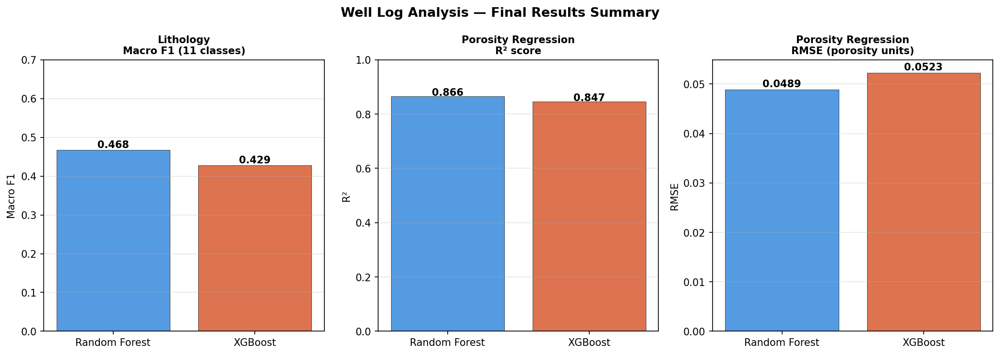

# Well Log Interpretation | Lithology & Density Porosity

A machine learning and petrophysical analysis workflow built on real Norwegian North Sea well logs from the FORCE 2020 benchmark. This project compares Random Forest and XGBoost models for multi-class lithology classification and density-derived porosity estimation, accompanied by portable notebook execution paths and a standalone well-log quality-control (QC) utility.

## Engineering workflow

1. Inspect well logs and missing measurements.
2. Clean curves and derive petrophysical features.
3. Split data by well to evaluate generalization to unseen wells.
4. Classify lithology and estimate density-derived porosity using independent log features.
5. Compare model metrics and examine depth-track plots.

## Dataset

This project uses the [FORCE 2020 competition repository](https://github.com/bolgebrygg/Force-2020-Machine-Learning-competition) and [archived dataset](https://zenodo.org/records/4351156). Obtain the competition training CSV (`CSV_train.csv`; semicolon-separated) from the [competition data folder](https://drive.google.com/drive/folders/0B7brcf-eGK8CRUhfRW9rSG91bW8) and place it in `data/raw/`. The notebooks split the labelled training file internally; the competition test file is not needed for this workflow. Follow the dataset's usage terms and do not commit raw data or model binaries.

| Curve | Engineering meaning |
| --- | --- |
| GR | Natural gamma radiation |
| RHOB | Bulk density |
| NPHI | Neutron porosity response |
| DTC | Compressional sonic transit time |
| RDEP | Deep resistivity |
| CALI | Borehole diameter |

## Model benchmark

| Task | Random Forest | XGBoost |
| --- | --- | --- |
| Lithology accuracy | 75.0% | 67.9% |
| Lithology macro F1 | 0.468 | 0.429 |
| Porosity RMSE (fraction) | 0.0489 | 0.0523 |
| Porosity R² | 0.866 | 0.847 |

Evaluation uses a well-based split of 79 training wells and 19 held-out wells. Porosity is calculated from bulk density with assumed matrix and fluid densities; it serves as a log-derived proxy rather than independent core-measured porosity. Class imbalance, missing logs, imputation, and geological variability constrain interpretation, and these results do not establish performance on ONGC wells.



## Repository structure

```text
notebooks/       # five-stage ML workflow
scripts/         # path setup script and standalone QC utility
tests/           # QC unit tests
docs/            # project documentation and technical notes
data/raw/        # local source data (not committed)
data/processed/  # local intermediate data
outputs/figures/ # generated plots and summary figures
outputs/models/  # locally trained models
```

## Run locally

From the repository root, using Python 3.10:

```bash
python -m venv .venv
# Windows PowerShell: .\.venv\Scripts\Activate.ps1
# macOS/Linux: source .venv/bin/activate
python -m pip install -r requirements.txt
python scripts/adapt_notebooks.py
python -m unittest discover -s tests
python -m jupyter notebook
```

Run notebooks `01` through `05` in numeric order. The standalone QC utility can be run independently before model training:

```bash
python scripts/log_qc.py data/raw/CSV_train.csv --well "15/9-13"
```
